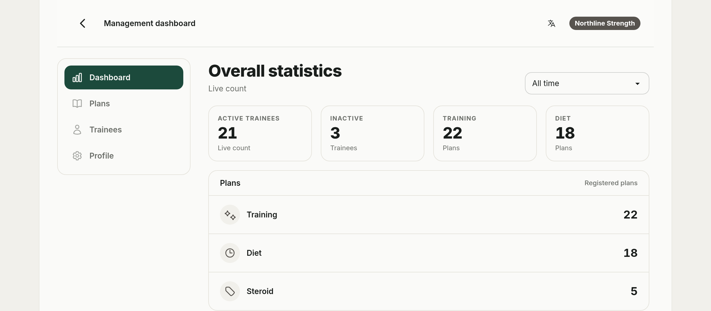
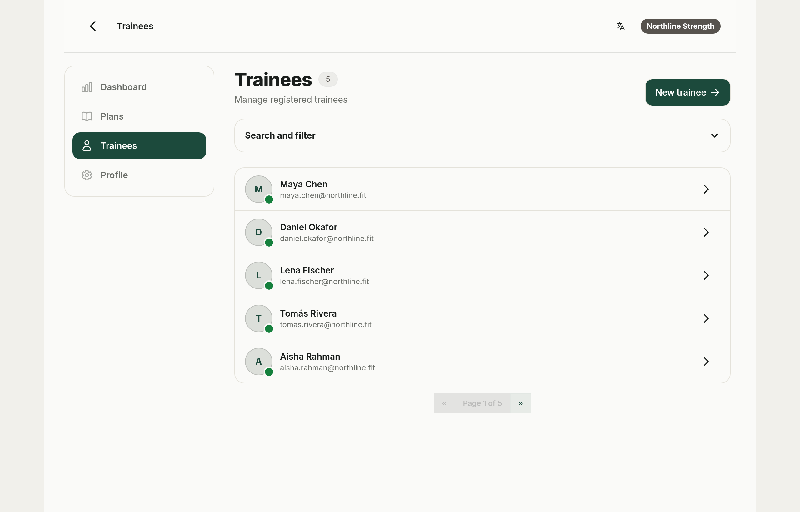
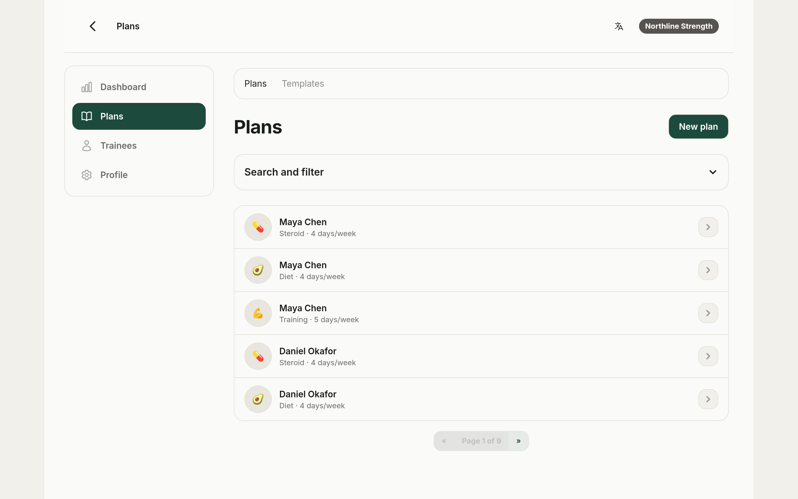
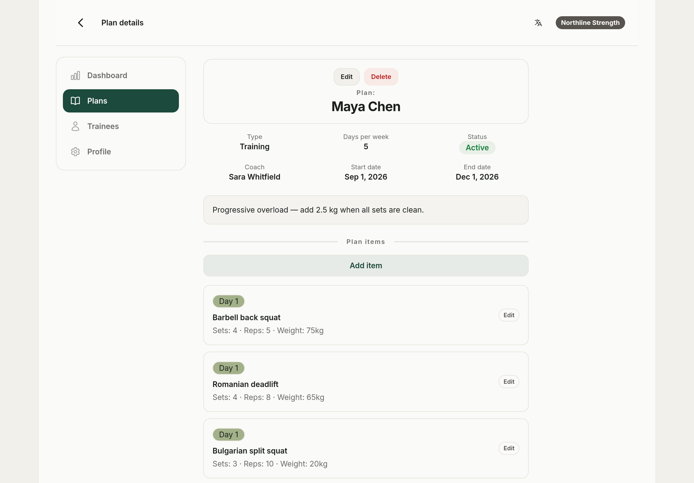
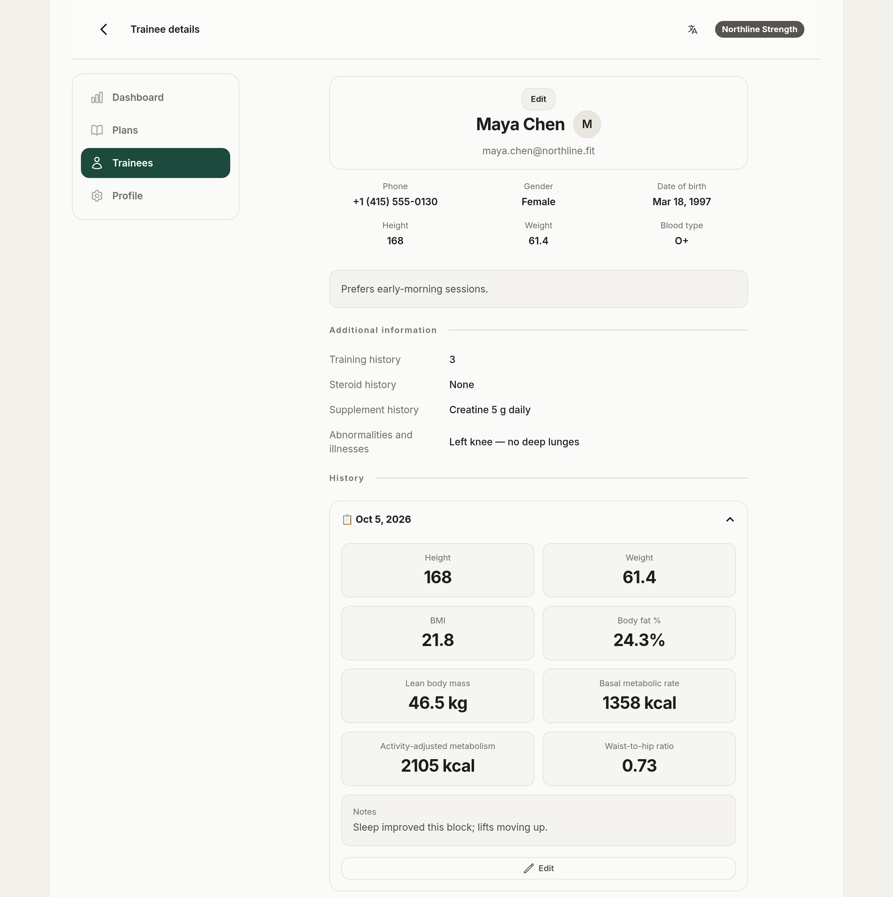
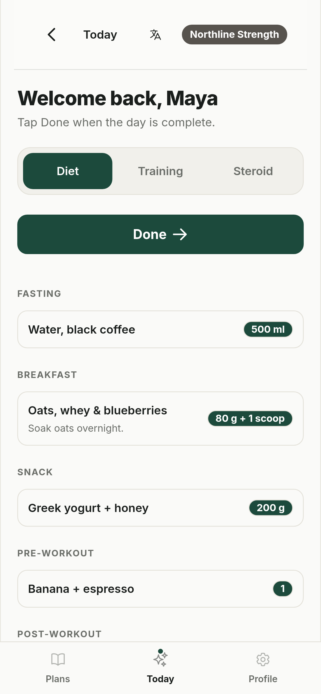
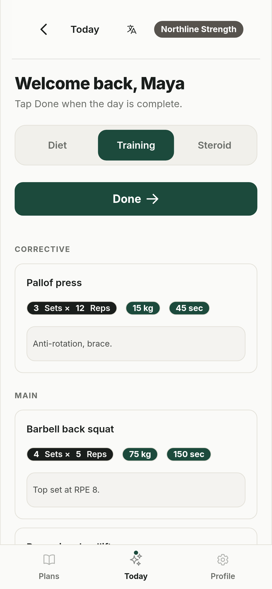
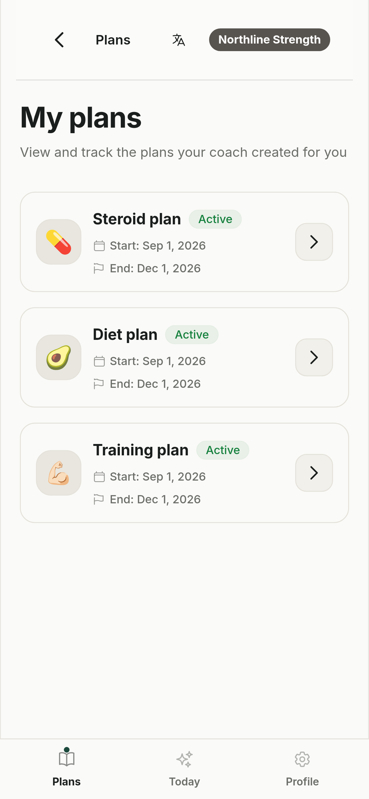
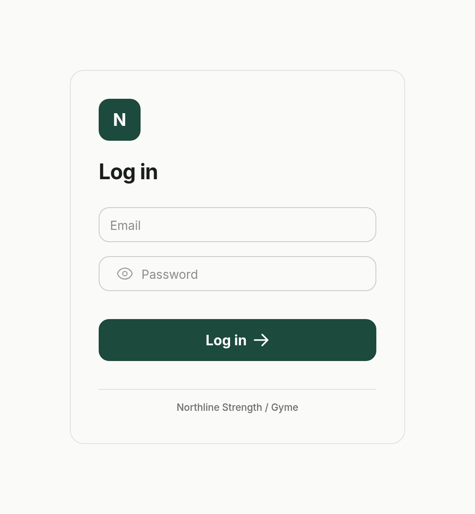

<p align="center">
  
</p>

<h1 align="center">Gyme</h1>

<p align="center">
  <strong>The gym app your members install — under your name.</strong><br>
  Training, nutrition and supplement plans. A daily “Today” view. Progress that tracks itself.
</p>

<p align="center">
  <a href="https://github.com/Rastin-Amani/Gyme/actions"></a>
  <a href="LICENSE"></a>
  <a href="https://github.com/Rastin-Amani/Gyme/releases"></a>
  <a href="https://github.com/Rastin-Amani/pkgs/container/gyme"></a>
</p>

<p align="center">
  
</p>

Most gyms already have a plan. It just lives in three places: a spreadsheet on the
office laptop, a PDF sent on WhatsApp, and a notebook in the gym bag. **Gyme replaces
all three** with one branded app where coaches publish the day's work and trainees
open **Today**, see exactly what to do, and tap **Done**.

Each gym gets its own hostname, logo, colors and installable PWA. The server renders
HTML with FastAPI and Jinja2; HTMX swaps fragments without a full reload. All records
live in your own [PocketBase](https://pocketbase.io) instance. Run it yourself under
the ISC license — or use the [managed cloud](https://app.gyme.cloud) and skip the
server work.

<p align="center">
  <a href="https://app.gyme.cloud"><strong>Start on the cloud version</strong></a> ·
  <a href="https://gyme.cloud/en/">Product tour</a> ·
  <a href="https://gyme.cloud/en/how-it-works">How it works</a> ·
  <a href="https://gyme.cloud/en/pricing">Pricing</a> ·
  <a href="https://gyme.cloud/en/open-source">Open-source page</a>
</p>

<p align="center">
  <sub>v0.11.1 · pre-1.0 · ISC licensed · 84 tests · CI runs ruff, black and pytest</sub>
</p>

## Contents

- [Why Gyme](#why-gyme)
- [Screenshots](#screenshots)
- [Cloud or self-host](#cloud-or-self-host)
- [What's inside](#whats-inside)
- [Quick start](#quick-start)
- [How it works](#how-it-works)
- [Architecture](#architecture)
- [Project structure](#project-structure)
- [Compare and migrate](#compare-and-migrate)
- [Security and privacy](#security-and-privacy)
- [Documentation](#documentation)
- [Known limitations](#known-limitations)
- [Deployment](#deployment)
- [Contributing](#contributing)
- [Internationalization](#internationalization)

## Why Gyme

- **Your gym's name, not ours.** Each hostname resolves to a tenant with its own logo,
  theme, icon and web manifest. Members install your app from your domain — no app
  store, no generic fitness brand in the middle.
  [Branded app →](https://gyme.cloud/en/features/branded-app)
- **Today beats a twelve-week PDF.** A plan is a sequence of days, not a document.
  Trainees see one day at a time; **Done** advances the pointer and the next day is
  ready. Coaches build from reusable templates.
  [Plans & the Today screen →](https://gyme.cloud/en/features/plans)
- **Progress that measures itself.** Height, weight, chest, waist, hip and arms go in;
  BMI, body-fat %, lean mass, BMR, TDEE and WHR come out. Up to five photos per
  assessment keep the visual history honest.
  [Progress tracking →](https://gyme.cloud/en/features/progress)
- **Roles that match the gym floor.** Owners see the whole gym, coaches see their own
  trainees and plans, trainees see only their plan. No shared logins, no accidental
  cross-gym access.
  [Management →](https://gyme.cloud/en/features/manage) ·
  [For owners →](https://gyme.cloud/en/for/owners) ·
  [For coaches →](https://gyme.cloud/en/for/coaches)
- **Open source, no lock-in.** ISC-licensed FastAPI + HTMX, data in PocketBase,
  deployment with Docker. Read the code, keep the data, change what you need.
  [Why open source →](https://gyme.cloud/en/open-source)

## Screenshots

Demo data is fictional: a seeded “Northline Strength” gym, its coaches, and 24 trainees,
all running the same build shown here. The full walkthrough is on the
[product tour](https://gyme.cloud/en/).

**Coach workspace** — live counters, a searchable roster, and every plan in one ledger.

| Trainee roster | Plan library |
|:---:|:---:|
|  |  |

**Plans and progress** — build training days item by item, then record an assessment;
BMI, body fat, lean mass, BMR, TDEE, and WHR are computed for you.

| Plan items | Progress history |
|:---:|:---:|
|  |  |

**Trainee app** — the phone-sized “Today” view: one plan section at a time, a single
**Done** action that advances the day, and the full plan library on the same dock.

| Diet | Training | My plans |
|:---:|:---:|:---:|
|  |  |  |

**White-label sign-in** — name, mark, theme, and manifest come from the gym's tenant
record, so every hostname opens as that gym's own app.

<p align="center">
  
</p>

## Cloud or self-host

Same product, two paths. The cloud removes the server work; self-hosting keeps every
record on infrastructure you control.

| | [Gyme Cloud](https://app.gyme.cloud) | Self-hosted |
| --- | --- | --- |
| Best for | gyms that would rather not run a server | teams with their own infrastructure |
| Setup | guided setup with the Gyme team | Docker + PocketBase |
| Where data lives | Gyme's managed infrastructure | your server |
| Branding | your domain, logo and colors | your domain, logo and colors |
| Cost | [from $29/mo by active trainees](https://gyme.cloud/en/pricing) | free to self-host, ISC license |
| Start | [app.gyme.cloud](https://app.gyme.cloud) | [Quick start](#quick-start) |

The [open-source page](https://gyme.cloud/en/open-source) explains the boundary in
plain terms. Choosing the cloud does not remove the self-hosted option.

## What's inside

| Area | What it does |
| --- | --- |
| [Branded app](https://gyme.cloud/en/features/branded-app) | Hostname-based tenants, per-gym logo/theme/manifest, installable PWA, offline fallback |
| [Plans & items](https://gyme.cloud/en/features/plans) | Training, diet and steroid plans with type-specific fields; reusable templates |
| [Progress logs](https://gyme.cloud/en/features/progress) | Body metrics with BMI/BFP/BMR/TDEE/LBM/WHR calculated automatically, plus up to 5 photos |
| [Roles](https://gyme.cloud/en/features/manage) | `owner`, `coach` (scoped to own trainees/plans), `trainee` (own plan only) |
| Dashboard | Trainee/plan counters and per-coach stats with week/month/all-time frames |
| PWA | Dynamic per-gym manifest, service worker caching, offline page/banner, iOS install flow |
| i18n | English (default), Spanish, Turkish and Armenian; cookie-based locale switching |

## Quick start

Prerequisites: Python 3.11+, Node.js, and a running PocketBase instance (≥ 0.17.1).

```bash
# 1. Python environment
python -m venv .venv
source .venv/bin/activate          # Windows: .venv\Scripts\activate
pip install -r app/requirements.txt

# 2. Frontend tooling (Vite + Tailwind)
npm install

# 3. Point the app at your PocketBase instance
export PB_URL="http://127.0.0.1:8090"    # matches the local default

# 4. Build static assets once (or run `npm run dev` for watch mode)
npm run build                       # outputs app/static/app.css + app.js

# 5. Run the app
uvicorn app.main:app --reload
```

Open the app on a hostname that matches a `domain` value of a record in your
PocketBase `tenants` collection (e.g. add `127.0.0.1 yourgym.local` to your hosts
file and browse `http://yourgym.local:8000`). The full walkthrough is in
[docs/02-getting-started.md](docs/02-getting-started.md); the product-level story
is in [How it works](https://gyme.cloud/en/how-it-works).

### Environment variables

| Variable | Default | Purpose |
| --- | --- | --- |
| `PB_URL` | `http://127.0.0.1:8090` | Base URL of the PocketBase instance |
| `ENV` | `dev` | Set to `production` to disable Swagger docs and `/debug/*` routes and switch logs to JSON |
| `ALLOWED_HOSTS` | *(unset)* | Optional comma-separated allowlist passed to Starlette `TrustedHostMiddleware`; in production a warning is logged when it is unset |

> Note: `python-dotenv` is listed in requirements but never invoked — `.env`
> files are **not** loaded automatically; export variables in the shell.

## How it works

Every request is resolved to a **gym (tenant)** by hostname. The tenant's members log
in with an email/password managed by the gym:

- **Owners** see gym-wide stats, manage **coaches** and **trainees**, build **plans**
  (training / diet / steroid) from reusable **templates**, and record body-metric
  assessments (**progress logs**) with photos.
- **Trainees** get a personal **Today** view that shows today's slice of each plan and
  a big **Done** button that advances them to the next day.

The server renders HTML (Jinja2 + Tailwind/daisyUI); HTMX swaps fragments and shows
toast notifications. All records, auth tokens and files live in PocketBase — the app
holds no database of its own. The result is installable per gym, caches its shell for
offline use, and works from a phone at the squat rack.

## Architecture

```
Browser (PWA, HTMX + Alpine.js)
   │  HTML over the wire
   ▼
FastAPI (app/main.py)
   ├── TenantMiddleware ── resolves tenant by Host header (PocketBase: tenants)
   │                    ── validates pb_auth cookie via PocketBase auth_refresh()
   ├── Routers (app/routes/**)        thin HTTP layer
   ├── Services (app/services/**)     PocketBase queries & business rules
   └── Jinja2 templates (i18n, locale-aware date filters)
   ▼
PocketBase (external)  ── collections: tenants, users, trainees, plans,
                          training_items, diet_items, steroid_items,
                          progress_logs, plan_progress, leads
                          (leads is written by the separate marketing app)
                          + auth tokens + file storage (logos, progress photos)
```

Deeper material: [docs/04-architecture.md](docs/04-architecture.md),
[docs/05-api-reference.md](docs/05-api-reference.md).

## Project structure

```
app/
├── main.py            # FastAPI app assembly, version, docs gating
├── middleware.py      # TenantMiddleware (tenancy + auth + request logging)
├── templates.py       # Jinja2 env + locale-aware date filters
├── pb.py              # PocketBase client factory (PB_URL)
├── utils.py           # hx_toast helper (HTMX toast headers)
├── logging_config.py  # structlog setup (console dev / JSON prod)
├── routes/            # feature routers (+ routes/user/ for trainee pages)
├── services/          # PocketBase access & business logic
├── templates/         # base, layouts, pages, forms, modals, components
└── static/            # built CSS/JS (Vite), service worker, fonts, swagger assets
data/                  # English exercise & food CSV datasets (dropdown sources)
docs/                  # product, architecture and operator docs + screenshots
Dockerfile             # python:3.11-slim, uvicorn on :8000
```

## Compare and migrate

The status quo is not a strawman. These pages look at what gyms actually use today,
including the trade-offs:

- [Paper & PDF plans](https://gyme.cloud/en/vs/paper-pdf) — the version problem
- [WhatsApp](https://gyme.cloud/en/vs/whatsapp) — when chat becomes the system of record
- [Spreadsheets](https://gyme.cloud/en/vs/spreadsheets) — the flexible file nobody opens
- [Generic fitness apps](https://gyme.cloud/en/vs/generic-apps) — someone else's brand on your coaching
- [Migration guide](https://gyme.cloud/en/migrate) — moving current plans into daily structure

## Security and privacy

Gyme handles health data, so the boring parts matter. Requests are tenant-scoped,
routes enforce role access, PocketBase filters are escaped, and the login route is
rate limited (5 attempts / 5 minutes per IP + identity + tenant). Cookies are
`HttpOnly`, `SameSite=Lax`, and `Secure` in production.

- [Security policy](SECURITY.md) and [security report](SECURITY_REPORT.md)
- [Data & security page](https://gyme.cloud/en/security) — where data lives and what is *not* claimed
- [Privacy policy](https://gyme.cloud/en/privacy) and [terms](https://gyme.cloud/en/terms)

## Documentation

| Document | Audience |
| --- | --- |
| [Product overview](docs/01-overview.md) | Everyone — what Gyme is and what it does |
| [Getting started](docs/02-getting-started.md) | Developers setting up a dev environment |
| [Architecture](docs/04-architecture.md) | Technical deep dive |
| [API reference](docs/05-api-reference.md) | All HTTP routes |
| [Configuration & deployment](docs/06-configuration-deployment.md) | Operators |
| [Troubleshooting & known issues](docs/07-troubleshooting-known-issues.md) | Everyone |

Product site: [home](https://gyme.cloud/en/) ·
[features](https://gyme.cloud/en/features) ·
[how it works](https://gyme.cloud/en/how-it-works) ·
[pricing](https://gyme.cloud/en/pricing) ·
[FAQ](https://gyme.cloud/en/faq) ·
[open source](https://gyme.cloud/en/open-source) ·
[security](https://gyme.cloud/en/security).

## Known limitations

Documented in detail in
[docs/07-troubleshooting-known-issues.md](docs/07-troubleshooting-known-issues.md).
Highlights:

- Accounts created in-app get a **random 15-character password**, shown **once** in
  the success toast after creation — copy it then, it is never displayed again.
  Recovering a lost one means a reset through the PocketBase admin.
- There is **no self-service password reset**; staff reset passwords through the
  PocketBase admin.
- A **rate limit** is enforced on the login route but not on password changes.

## Deployment

A `Dockerfile` is provided (Python 3.11-slim, uvicorn on port 8000 with proxy header
support). Static assets must be built before the image is built because Node/Vite
files are excluded from the image.

Pre-built images are published to **GHCR** on every push to `main` (tag `latest`) and
on version tags (e.g. `v0.9.1`):

```bash
docker pull ghcr.io/rastin-amani/gyme:latest

# Point the container at your PocketBase instance (required)
export PB_URL="http://127.0.0.1:8090"

docker run --rm -p 8000:8000 \
  -e PB_URL="$PB_URL" \
  -e ENV=production \
  ghcr.io/rastin-amani/gyme:latest
```

Browse it on a hostname that matches a `tenants` record (add
`127.0.0.1 yourgym.local` to your hosts file and open
`http://yourgym.local:8000`). Set `ALLOWED_HOSTS` in production.

Full runbook:
[docs/06-configuration-deployment.md](docs/06-configuration-deployment.md).
If you would rather skip server maintenance, the same product runs at
[app.gyme.cloud](https://app.gyme.cloud).

## Contributing

Contributions are welcome — see [CONTRIBUTING.md](CONTRIBUTING.md) for setup, code
conventions (thin routes, logic in services, gettext `_("…")` UI strings), and the PR
checklist (`make test`, `ruff check .`, `black .`).

Good first issues: docs corrections, translations, accessibility and HTMX
progressive-enhancement fixes. For anything larger, open a discussion before writing
the patch.

## Internationalization

Languages (cookie-based): **en** (default, LTR, source msgids), **es**, **tr**, **hy**.

- The switcher sets the `locale` cookie for 1 year via `GET /locale/{code}?next=...`
  and reloads the page.
- `<html lang dir>` follows the locale — every locale is LTR.
- UI strings use `_("…")` in Jinja and Python (English msgids + gettext catalogs under
  `app/locales/`).

```bash
make i18n-extract        # refresh messages.pot
make i18n-add LOCALE=de  # enable a new language (also flip enabled=True in app/i18n.py)
make i18n-update         # merge new msgids into existing .po files
make i18n-compile        # build .mo
```

To add a language: register it in `app/i18n.py` (`enabled=True`), run
`make i18n-add LOCALE=xx`, translate the `.po`, then `make i18n-compile`.

---

Licensed under the [ISC License](LICENSE). Built with FastAPI, HTMX, Tailwind CSS,
daisyUI and PocketBase.
